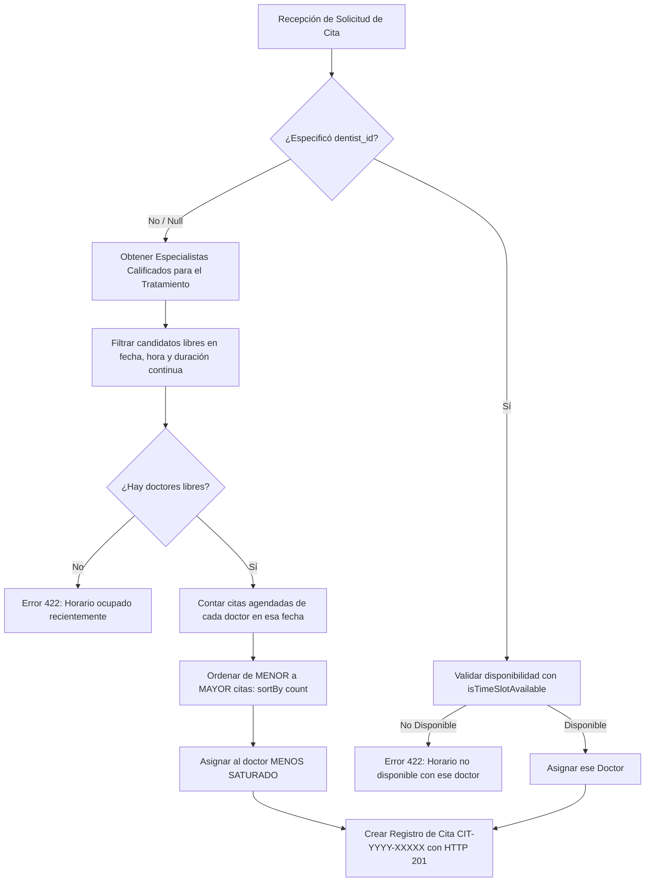

# Algoritmo de Reservas y Asignación Inteligente de Pacientes
### Aura Dental Studio — Documentación Técnica y de Negocio

---

## 1. Filosofía y Arquitectura del Sistema

El flujo de reservas online de **Aura Dental Studio** está diseñado bajo los mejores estándares de experiencia de usuario (UX) utilizados por las principales clínicas odontológicas internacionales, combinando:

1. **Cero Fricción para el Paciente:** Evita que el usuario tenga que adivinar qué doctor está libre o qué especialista realiza cada procedimiento.
2. **Balanceo de Carga Automático (Load Balancing):** Distribuye equitativamente las consultas entre los odontólogos calificados para evitar saturación de agenda.
3. **Generación Precisa de Slots a 30 Minutos:** Despliega horarios uniformes de inicio cada 30 minutos sin proyectar horas fantasma fuera del turno médico.
4. **Validación Continua de Duración Real:** Evita el solapamiento o sobreturnos cuando los tratamientos requieren tiempos variables (e.g., 30 min, 45 min, 60 min, 90 min).
5. **Fidelidad Clínica para Pacientes Antiguos:** Permite que los pacientes recurrentes elijan a su odontólogo de cabecera si así lo prefieren.

---

## 2. El Flujo de Usuario en 3 Pasos

```
[ PASO 1 ] ─────────────────────────► [ PASO 2 ] ─────────────────────────► [ PASO 3 ]
1. Tipo de Paciente                  1. Carrusel de Fechas y Turnos        1. Datos de Contacto
   • Soy Paciente Nuevo                 • Carrusel semanal con flechas < >    • Nombre, Email, Teléfono
   • Ya soy Paciente                    • Conteo de cupos libres por día      • Motivo / Síntomas
2. Selección de Tratamiento             • Selector modal de calendario nativo 2. Confirmación
   • Catálogo limpio de 2 columnas   2. Asignación y Selección de Horarios    • Código CIT-YYYY-XXXXX
   • Duración estimada vinculada        • Paciente Nuevo: Asignación Auto     • Botón 1-Clic a WhatsApp
                                        • Ya Paciente: Elección de Doctor
                                     3. Bloques Mañana / Tarde (Pill-buttons)
```

### Paso 1: Tipo de Paciente y Selección del Tratamiento
* **¿Eres paciente nuevo o recurrente?**
  * `[ Soy Paciente Nuevo ]`: Primera consulta, diagnóstico o urgencia (`is_first_visit = 1`).
  * `[ Ya soy Paciente ]`: Ya cuenta con historial o ficha clínica en el centro (`is_first_visit = 0`).
* **Selección de Tratamiento:**
  * Tarjetas limpias en cuadrícula de 2 columnas con borde cian activo y círculo de selección tipo radio a la derecha.
  * Cada servicio tiene configurada su **duración estimada en minutos** (`duration_minutes`).
  * Al hacer clic en un tratamiento, se selecciona de forma interactiva y desbloquea el botón de avance hacia el Paso 2.

---

### Paso 2: Carrusel de Fechas, Especialistas y Horarios

#### A. Carrusel Horizontal de Fechas:
* **Navegación Intuitiva:** Barra horizontal con pestañas para los próximos 7 días, navegable con flechas laterales (`<` y `>`).
* **Indicadores en Tiempo Real:** Cada pestaña muestra el día de la semana (ej. *LUN*, *MAR*), el día del mes, un badge con la cantidad de cupos disponibles (`X libres` o `Agotado`), y una barra inferior cian para la fecha activa.
* **Acceso Directo con Calendario:** Botón rápido de calendario que abre un modal con el selector nativo para saltar a cualquier fecha futura sin límite de semanas.

#### B. Asignación Inteligente vs. Elección de Dentista:
* **Si es Paciente Nuevo (`is_first_visit = 1`):**
  * Flujo ultralimpio y directo: no se muestran bloques de texto innecesarios ni banners de explicación para no saturar la vista. Pasa de forma inmediata a la elección de fecha y hora.
  * Los horarios mostrados son **horarios unificados (fusionados)** de todos los doctores activos que realizan dicho tratamiento, asignando en background por balanceo de carga al especialista con mayor disponibilidad.
* **Si ya es Paciente (`is_first_visit = 0`):**
  * Se presenta el bloque interactivo: **«¿Deseas elegir a tu dentista de preferencia?»**
  * Opción 1: `[ Primer Especialista Disponible ]` *(Por defecto)* -> Muestra los horarios unificados y asigna por balanceo de carga.
  * Opción 2+: Tarjetas individuales de los doctores que realizan ese tratamiento con su foto y especialidad. Si el paciente selecciona un doctor específico, la grilla se filtra **únicamente** a los horarios de ese profesional.

#### C. Grilla de Horarios (Pill Buttons en 12 Horas AM/PM):
* **Estructura Vertical Dividida:** Los horarios se agrupan en dos secciones verticales con iconos SVG limpios (sin emojis):
  * **Turno Mañana:** Icono de sol naciente matutino (`09:00 AM` a `12:30 PM`).
  * **Turno Tarde:** Icono de atardecer vespertino (`02:00 PM` a `06:00 PM`).
* **Estilo de Botones (Pills):**
  * **Disponible:** Botón blanco con tipografía nítida en formato 12 horas (ej. `10:30 AM`, `03:00 PM`).
  * **Seleccionado:** Fondo cian esmeralda corporativo con texto blanco y checkmark.
  * **No Disponible (Ocupado o Choque):** Botón deshabilitado con fondo gris claro, texto tachado (`line-through`) y cursor no permitido.

---

### Paso 3: Datos de Contacto y Confirmación
* Previsualización resumida de la cita: Tratamiento, Especialista asignado (o preferencia), Tipo de Paciente y Fecha/Horario formateado.
* Campos obligatorios: Nombre completo, correo electrónico y teléfono móvil/WhatsApp.
* Al confirmar:
  1. Se registra la cita con estado inicial `pending`.
  2. Se genera un código de reserva único rastreable (e.g. `CIT-2026-B81C9`).
  3. Se presenta la pantalla de éxito con ticket descargable y botón directo para **Confirmar por WhatsApp con Recepción con 1 solo clic**.

---

## 3. Lógica Matemática del Algoritmo

### A. Generación de Slots e Integridad de Límites de Turno
El generador de horarios (`Dentist::generateShiftSlots`) itera en intervalos exactos de **30 minutos**.

#### Regla de Fin de Turno (Eliminación de Slots Fantasma):
En versiones anteriores, el generador creaba casillas hasta el final del turno y marcaba como deshabilitada la última casilla si el tratamiento excedía el límite (por ejemplo, mostrar `12:30 PM` tachado para un tratamiento de 60 minutos cuyo turno finaliza a las 13:00). Esto inducía al usuario al error visual de creer que las 12:30 ya estaban ocupadas por otro paciente.

**Implementación Actual:**
El bucle solo genera horarios de inicio si el procedimiento completo cabe dentro del turno médico:
```php
// En app/Models/Dentist.php (generateShiftSlots):
while ($current->copy()->addMinutes($durationMinutes)->lte($shiftEnd)) {
    $timeStr = $current->format('H:i');
    $slotStart = $current->copy();
    $slotEnd = $current->copy()->addMinutes($durationMinutes);

    // Comprobar colisión en toda la ventana de duración
    $isColliding = false;
    foreach ($existingAppointments as $app) {
        if ($slotStart->lt($app['end']) && $slotEnd->gt($app['start'])) {
            $isColliding = true;
            break;
        }
    }

    $slots[] = [
        'time' => $timeStr,
        'shift' => $shift, // 'morning' | 'afternoon'
        'available' => ! $isColliding,
    ];

    $current->addMinutes(30);
}
```
* **Consecuencia:** Para un turno de mañana de 09:00 a 13:00:
  * Con tratamiento de **30 min**: Genera casillas desde las `09:00 AM` hasta las `12:30 PM` (12:30 a 13:00 es válido).
  * Con tratamiento de **60 min**: Genera casillas desde las `09:00 AM` hasta las `12:00 PM` (12:00 a 13:00 es válido). No se genera la casilla de las 12:30 PM porque no puede iniciar una cita de 1 hora a solo 30 minutos del cierre.

---

### B. Validación de Duración Real y Detección de Colisiones
Dado un horario solicitado que inicia en `$slotStart` y finaliza en:
$$\text{slotEnd} = \text{slotStart} + \text{durationMinutes}$$

1. **Límites de Turno y Descanso de Colación:**
   $$\text{slotStart} \ge \text{shiftStart} \quad \text{y} \quad \text{slotEnd} \le \text{shiftEnd}$$
   *(Si el turno termina a las 13:00, una solicitud a las 12:30 para 60 min es rechazada con HTTP 422 sin guardarse en base de datos).*

2. **No Solapamiento con Citas Existentes:**
   Existe solapamiento con cualquier cita agendada `[appStart, appEnd]` si y solo si:
   $$\text{slotStart} < \text{appEnd} \quad \text{y} \quad \text{slotEnd} > \text{appStart}$$

#### Caso Práctico de Colisión (60 minutos con cita a las 12:30):
* Un dentista tiene una cita de 30 minutos ya confirmada a las `12:30` (ocupa de 12:30 a 13:00).
* Un paciente solicita un tratamiento de 60 minutos a las `12:00` (requiere de 12:00 a 13:00).
* **Resultado:**
  * La casilla de las `12:00 PM` se marca como `available: false` (deshabilitada y tachada).
  * Si un cliente intenta forzar el POST a `/appointments` a las `12:00`, la API devuelve un error `422 Unprocessable Entity` y el registro **no se inserta** en la base de datos.
  * La casilla de las `11:30 AM` (11:30 a 12:30) se mantiene completamente disponible y puede reservarse con éxito (HTTP 201).

---

### C. Algoritmo de Balanceo de Carga (Least-Saturated Dentist)

Cuando un paciente nuevo agenda (o un paciente recurrente elige *"Primer especialista disponible"*), el backend en `AppointmentBookingController::store` ejecuta el balanceo de carga:



#### Implementación en Código (`AppointmentBookingController.php`):
```php
// 1. Obtener odontólogos activos calificados para este tratamiento
$candidates = $service->dentists()->where('is_active', true)->get();
if ($candidates->isEmpty()) {
    $candidates = Dentist::where('is_active', true)->get();
}

// 2. Filtrar doctores con disponibilidad real continua
$availableCandidates = $candidates->filter(function (Dentist $doc) use ($date, $time, $duration) {
    return $doc->isTimeSlotAvailable($date, $time, $duration);
});

// 3. Balanceo de Carga: Seleccionar al doctor con menor número de citas en esa fecha
$assignedDentist = $availableCandidates
    ->sortBy(function (Dentist $doc) use ($date) {
        return $doc->appointments()
            ->whereDate('appointment_date', $date)
            ->whereIn('status', ['confirmed', 'pending'])
            ->count();
    })
    ->first();

$dentistId = $assignedDentist->id;
```

---

## 4. Protocolo Operativo para Recepción (Sin SMS Masivo)

Al prescindir de servicios externos de SMS masivo (como Twilio), la clínica opera con el flujo estándar de confirmación manual asistida por software:

1. **Alerta Instantánea de Reserva:**
   * La cita ingresa al panel Filament con estado `pending` (color ámbar).
   * El paciente puede hacer clic en el botón de WhatsApp al terminar su reserva, lo que abre una conversación directa con recepción con los detalles de su código `CIT-YYYY-XXXXX`.
2. **Revisión Matutina y Vespertina por Secretaría:**
   * La recepcionista filtra en Filament las citas del día siguiente en estado `pending`.
   * Realiza una llamada de cortesía o envía mensaje directo vía el botón de WhatsApp integrado en Filament.
3. **Actualización de Estados en Filament:**
   * `confirmed` (Verde): El paciente confirmó su asistencia.
   * `left_message` (Azul): Se le dejó recado de confirmación.
   * `completed` (Gris): Consulta realizada con éxito.
   * `cancelled` / `no_show` (Rojo): Cupo liberado inmediatamente para otros pacientes.

---

## 5. Pruebas Automatizadas de Cobertura (PHPUnit)

El flujo completo de reservas y la clínica cuentan con **26 pruebas especializadas** en `tests/Feature/DentalClinicPublicTest.php` y **38 pruebas en toda la suite** del proyecto (167 aserciones, 100% pasando):

| Test Automatizado | Escenario y Caso de Uso Validado |
| :--- | :--- |
| `test_patient_type_selection_flow_with_first_visit_and_returning_patient` | Valida la persistencia del flag `is_first_visit` tanto para pacientes nuevos (`1`) como recurrentes (`0`). |
| `test_booking_assigns_least_saturated_dentist_when_no_dentist_selected` | Paciente nuevo: entre múltiples doctores disponibles, el sistema asigna automáticamente al doctor con menor carga de citas en esa fecha. |
| `test_returning_patient_booking_with_first_available_assigns_least_saturated` | Paciente recurrente que elige *"Primer especialista disponible"*: se beneficia del mismo balanceo inteligente de carga. |
| `test_returning_patient_can_choose_preferred_dentist_specifically` | Paciente recurrente que elige a un dentista en particular: el sistema respeta la elección y asigna estrictamente a ese profesional. |
| `test_slots_api_returns_30_minute_intervals_and_hides_slots_exceeding_shift_end` | Comprueba que la API `/api/appointments/available-slots` entregue casillas a 30 minutos y no genere horas de inicio que rebasen el fin de turno. |
| `test_booking_fails_and_does_not_save_when_treatment_duration_exceeds_shift_boundary` | Intento de agendar un tratamiento que supera la hora de cierre del turno: se rechaza con HTTP 422 y `assertDatabaseMissing`. |
| `test_booking_fails_and_does_not_save_when_multi_slot_treatment_collides_with_existing_appointment` | Intento de agendar un tratamiento multicasilla (ej. 60 min) que solapa con otra cita existente: se rechaza con 422 y `assertDatabaseMissing`. |
| `test_booking_succeeds_and_saves_when_multi_slot_treatment_fits_entirely_in_free_window` | Tratamiento multicasilla (60 min) en un espacio continuo libre: se confirma con HTTP 201 y se guarda en la base de datos con `assertDatabaseHas`. |
| `test_when_1230_is_occupied_by_an_appointment_a_60_minute_treatment_at_1200_is_marked_unavailable_and_rejected` | Con una cita a las 12:30, la casilla de las 12:00 para 60 min se marca `available: false` en la API y cualquier intento de reserva a las 12:00 es rechazado con 422. |
| `test_dentist_shift_schedule_respects_morning_afternoon_and_lunch_break` | Comprueba que los horarios respeten el almuerzo médico (13:00 - 14:00) y las ventanas de mañana y tarde. |

### Ejecución de Pruebas:
```bash
# Ejecutar la suite completa del proyecto
php artisan test --compact

# Ejecutar el archivo de pruebas de reservas públicas
php vendor/phpunit/phpunit/phpunit tests/Feature/DentalClinicPublicTest.php --colors=never
```
Resultado global: **OK (38 tests, 167 assertions)**
